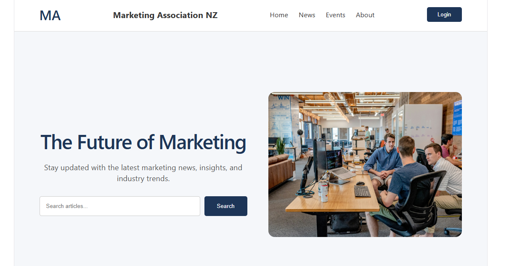

# Marketing Association NZ - Digital News Homepage

## Overview

This project was completed as part of the Mission Ready Tech Career Accelerator (Mission 0).

The objective was to build a responsive homepage prototype for the Marketing Association New Zealand digital news website based on the provided wireframe.

## Features

- Responsive homepage layout
- Built with React
- Reusable components
- Mobile-friendly design
- Modern CSS using Flexbox/Grid
- Search bar UI (non-functional as required)

## Technologies Used

- React
- JavaScript (ES6+)
- HTML5
- CSS3
- Vite

## Getting Started

### Prerequisites

- Node.js
- npm

### Installation

```bash
git clone <repository-url>
cd <project-folder>
npm install
```

### Run the Project

```bash
npm run dev
```

The application will start on:

```
http://localhost:5173
```

## Project Structure

```
src/
├── components/
├── assets/
├── App.jsx
├── App.css
└── main.jsx
```

## Screenshot



## Future Improvements

- Implement search functionality
- Connect to a real news API
- Add category filtering
- Improve accessibility
- Add animations

## Author

Iskren Petrov

Mission Ready – Tech Career Accelerator
